# evolvehack

**Open-source Flipsky / VESC conversion for the Evolve Hadean electric skateboard.**

This repo documents how a 2022 Evolve Hadean with a failed battery PCB was brought back to life by replacing the proprietary Evolve electronics with open, repairable parts: a Flipsky Dual FSESC6.7 Plus motor controller, a Flipsky VX4 Pro remote and a separate Bluetooth smart BMS, keeping the original deck, trucks and cells.

If your Hadean cuts out mid-ride, powers on only sometimes, or has been quoted a whole new battery for what looks like a connection fault, this is for you.

> **Status: work in progress.** The board is rebuilt and powering up: pack repaired, new BMS charging and balancing, controller and motors fitted in a 3D-printed enclosure, remote paired. Configuration, printable files and ride testing are still being written up. See [Roadmap](#roadmap).

---

## Why this project exists

The board is a second-hand 2022 Hadean with under 900 km on it and a healthy set of cells. It died anyway, and the failure was not the cells, the motors or the controller. It was the circuit board the cells are mounted to.

The stock pack is a single assembly: cells, BMS, power switch input and the mains connector to the motor controller all live on one PCB. When that board cracks, the official fix is a replacement battery. The board was out of warranty, the local repair queue was around two months, and a new battery costs roughly three times what the open-source parts do.

So the board gets an open drivetrain instead: parts that can be bought from more than one supplier, configured with free tools, and repaired one piece at a time.

## The fault

### Symptoms, in the order they showed up

| When | What happened |
|---|---|
| Oct 2025 | Battery cut out at around 10 km range on two rides in a row. |
| Oct 2025 | Pack opened: 12S4P of 21700 cells (16 Ah). Parallel groups measured about 4.18 V each, yet the pack read only 40.8 V with the charger showing green. A healthy full 12S pack should read about 50.4 V. |
| Nov 2025 | Small JST connector from the power switch to the battery PCB found working loose with vibration. Hot glue held it for a couple of test rides, then it failed again. |
| Nov 2025 | Bad joint found at the switch end of the power switch lead. Cut back, re-soldered and heat-shrunk; switch tested good for continuity. Board still would not power on, although the red LED on the BMS was lit. |
| Nov 2025 | Board intermittently powered up, ran its LED sequence, then shut off again with the BMS LED still on. |
| Dec 2025 | Root cause found (below). |

### Root cause

**Cracked internal traces in the main battery PCB, around cell groups B8 and B9.**

The cracks are inside the board's copper pathways, not at a solder joint, so they are invisible from the surface. Flexing the end of the battery assembly by hand switches the board on and off. On the road, deck flex and vibration do the same thing, which explains every symptom above: random cut-outs, the low pack voltage reading across a broken series link, and a board that works on the bench and dies on the ride.

The power switch lead and its JST connector were real faults too, and worth checking first because they are quick to fix. They were not the whole story.

### How to check your own board

1. **Measure each parallel group, then the whole pack.** If the groups add up to much more than the pack voltage, a series connection is open somewhere between them.
2. **Tug-test the power switch wires** at the switch end, one at a time, and check the small JST connector on the battery PCB is fully seated.
3. **Flex test.** With the pack out and a meter across the main output, gently flex the PCB along its length. Voltage dropping in and out points to a cracked trace.
4. **Narrow it down.** Probe group to group along the series chain while flexing to find which link is breaking.

## The upgrade

### What stays

- Deck, trucks and wheels
- The original 21700 cells (12S4P), still mounted on the original battery PCB, with the cracked series paths bypassed (see [Battery repair](#battery-repair))

### What goes

- The Evolve BMS on the battery PCB
- Evolve motor controller
- Evolve remote and its receiver (the stock remote only talks to the stock controller)
- Stock motors

### What replaces it

| Part | Replacement | Notes |
|---|---|---|
| Motor controller | Flipsky Dual FSESC6.7 Plus with aluminium case | VESC 6-based dual controller, one unit drives both motors |
| Motors | 2 x Glide 6374, 190 KV, 3500 W | From glide-esk8.co.nz |
| Remote | Flipsky VX4 Pro | With its matching receiver |
| BMS | Bluetooth smart BMS, common port | Separate, replaceable board in the battery bay. Model to be confirmed |
| Cell interconnects | Series links bridged at the cell tabs | Pack current no longer depends on the PCB's internal traces |
| Power switch | Illuminated metal push button | Mounted in the controller enclosure |
| Controller enclosure | 3D-printed two-part case with gasket | Bolts to the rear of the deck. Print files to be added |
| Main leads | 12 AWG silicone wire | Pack to controller |
| Configuration | [VESC Tool](https://vesc-project.com/vesc_tool) | Free, open source |

| Controller | Motor | Remote |
|---|---|---|
| 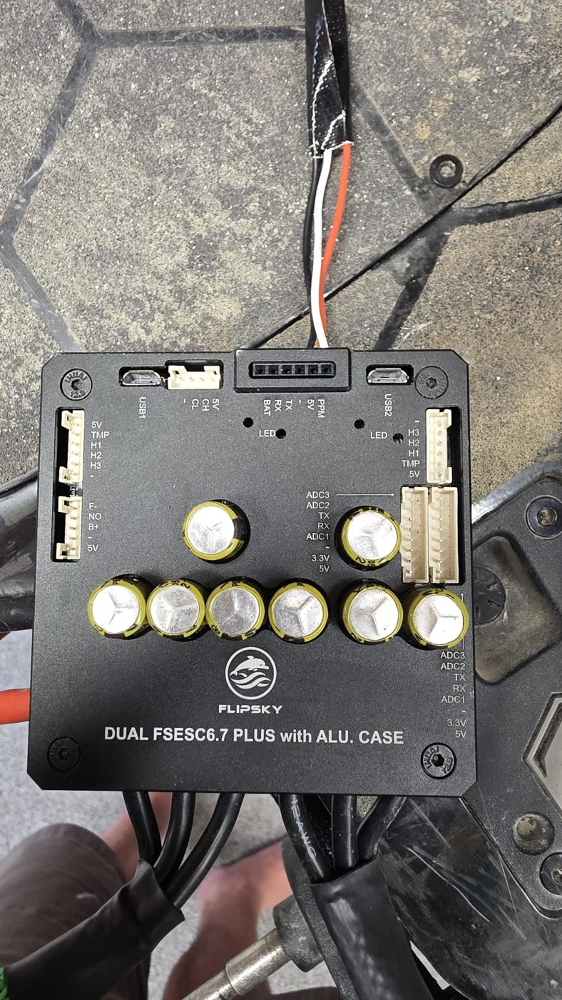 | 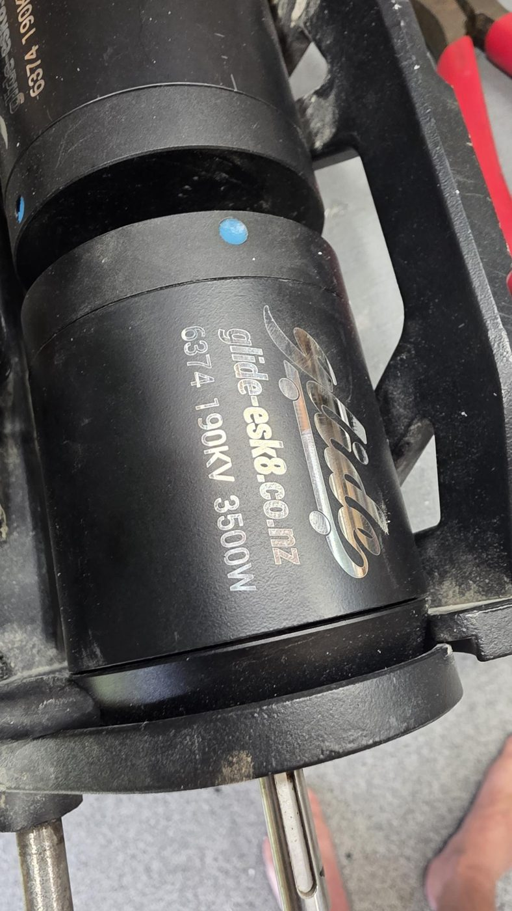 | 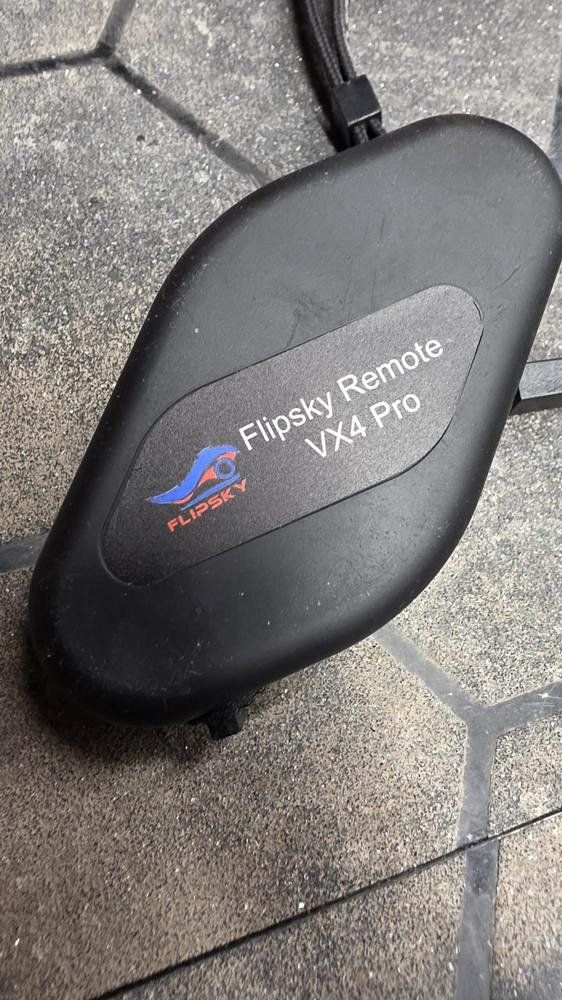 |

### Battery repair

The cells were left on the original Evolve battery PCB. Rather than trusting the board's internal copper to carry pack current, each series link is bridged directly at the nickel cell tabs, so the cracked traces around B8 and B9 are out of the circuit.

- Series links soldered across the tab pairs between neighbouring cell groups, B1 through B12
- New 24 AWG balance leads soldered to each group's tab and run back to the new BMS
- New 12 AWG main positive and negative leads taken straight from the B12+ and B0 tabs
- Exposed joints sealed with liquid electrical tape
- The original BMS end of the PCB removed, with the new BMS and its Bluetooth module mounted in the freed space

| Battery bay | B8 to B10, where the fault was | B10 to B12 and main positive |
|---|---|---|
| 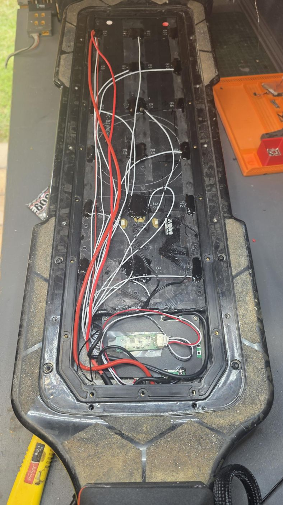 | 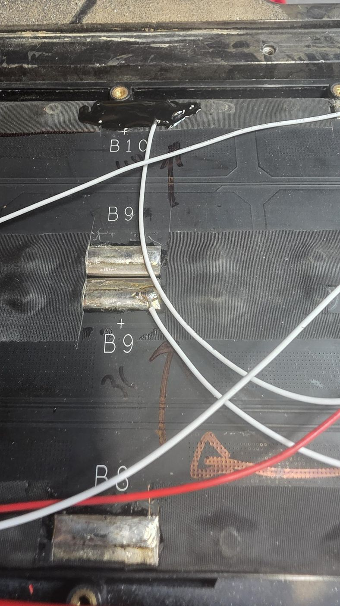 | 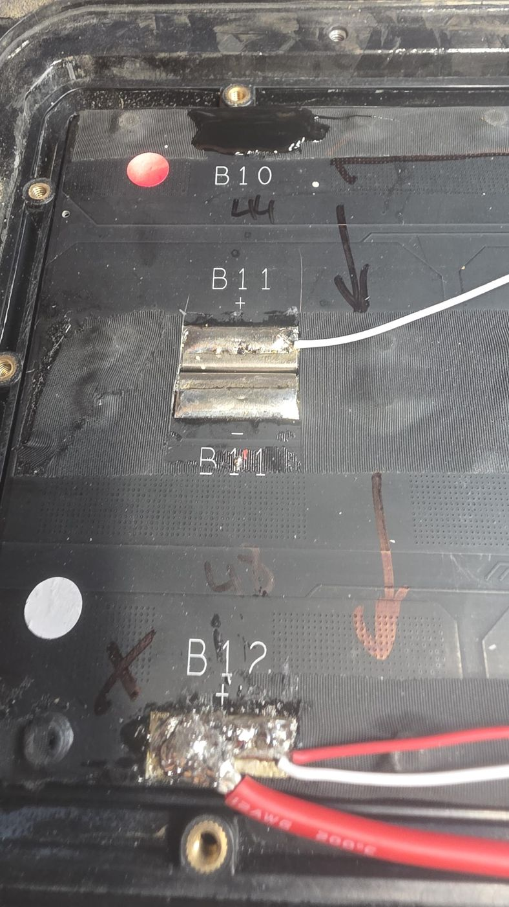 |

More close-ups: [B0 to B2](images/battery-pcb-b0-b2.jpg), [B4 to B6](images/battery-pcb-b4-b6.jpg), [B6 to B8](images/battery-pcb-b6-b8.jpg).

### BMS

The new BMS is a common-port Bluetooth smart BMS: pack negative goes to B-, charger and controller negative share C-, and pack positive goes straight to the charger and controller. Balance leads plug into the BMS, and a small Bluetooth module gives live cell voltages, current and temperatures in a phone app.

| BMS Bluetooth module | App while charging |
|---|---|
| 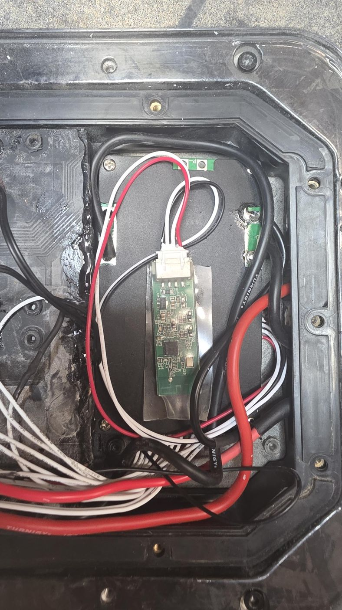 | 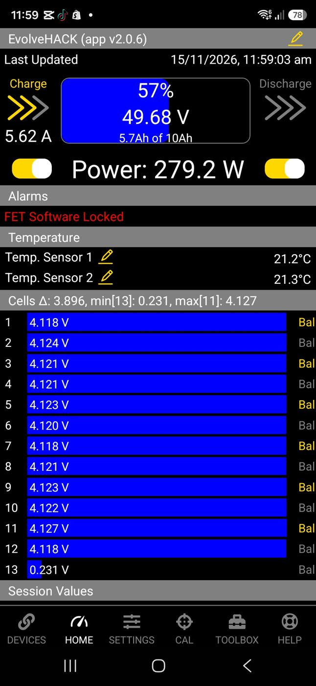 |

With the series links bridged, all 12 groups sit within about 10 mV of each other and the pack reads its full voltage again, compared with 40.8 V before the repair.

**Known issue:** the BMS has 13 cell channels and the pack is 12S, so the app shows a phantom cell 13 at about 0.23 V. Cell count and pack capacity still need setting correctly in the BMS (see Roadmap).

### Controller enclosure

The FSESC6.7 Plus sits in a 3D-printed two-part enclosure at the rear of the deck, with a gasket between the halves and the power button in the end face. Motor phase leads exit underneath in braided sleeving.

| Rear drive | Enclosure | Side |
|---|---|---|
| 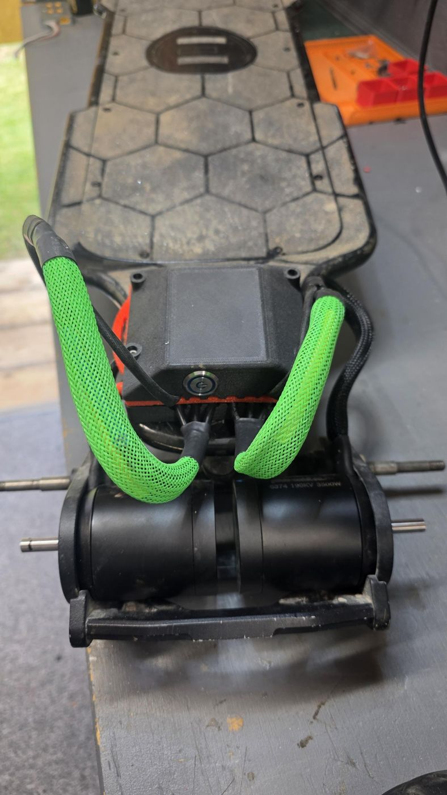 | 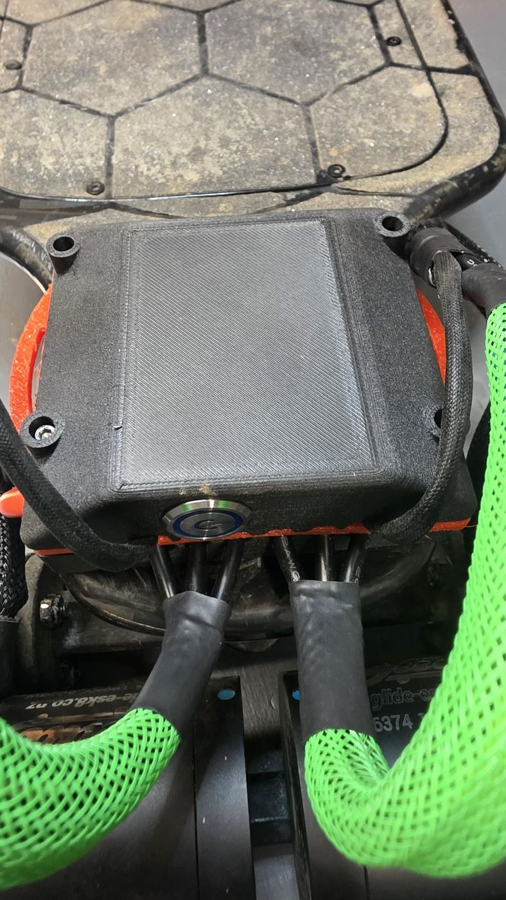 | 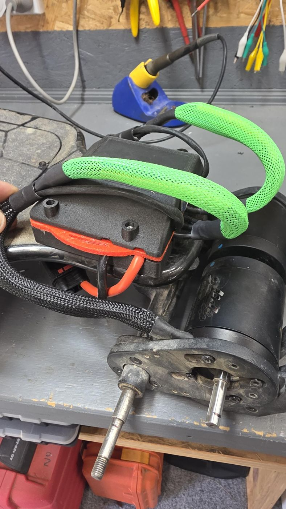 |

### VESC setup so far

- Connected to VESC Tool on Android over Bluetooth
- The two sides of the dual controller are linked over CAN: local VESC ID 69, second VESC ID 7
- CAN baud rate 500K
- Remote input connected to the local VESC (ID 69)

### Controller ports

The FSESC6.7 Plus case is labelled with its pinouts, which makes wiring far easier than the stock controller. As printed on the case:

| Port | Pins | Used for |
|---|---|---|
| Hall sensor (one per motor) | 5V, TMP, H1, H2, H3, GND | Motor hall sensors and temperature |
| Receiver | PPM, 5V, GND, TX, RX, BAT | Remote receiver |
| COMM (one per side) | ADC3, ADC2, TX, RX, ADC1, GND, 3.3V, 5V | UART and analogue inputs |
| CAN | 5V, CH, CL, GND | CAN bus accessories, such as a BMS |
| Switch | F-, NO, B+, GND, 5V | Power button |
| USB1 / USB2 | Micro USB | VESC Tool, one port per motor side |

A full bill of materials with part numbers, suppliers and prices will be added once the build is finalised.

## Roadmap

- [x] Diagnose the fault
- [x] Bypass the cracked PCB traces and fit new balance and main leads
- [x] Fit and wire the new BMS
- [x] Fit controller, motors and remote
- [x] Design and print the controller enclosure
- [x] Build photos
- [ ] Set BMS cell count to 12 and pack capacity to 16 Ah, and clear the phantom cell 13
- [ ] Bill of materials with part numbers and costs
- [ ] Wiring diagram: pack, BMS, ESC, motors, charge port
- [ ] Motor phase and hall sensor wiring for the Glide 6374 motors
- [ ] Enclosure print files (STL / STEP) and print settings
- [ ] VESC Tool motor detection results and configuration files
- [ ] Throttle curve and current limit tuning
- [ ] Ride testing and range figures

## Also in this repo

- `LarsonScannerTrinketM0` is an Arduino sketch for a 16-pixel NeoPixel "Larson scanner" light bar on an Adafruit Trinket M0, adapted from Adafruit's example (MIT). Board lighting, unrelated to the drivetrain.

## Safety

This is high-energy lithium work. A 12S4P pack of 21700 cells can deliver hundreds of amps into a short circuit and will start a fire if mishandled.

- Do not attempt this unless you are comfortable building and repairing lithium packs.
- Insulate everything, work on one connection at a time, and keep metal tools away from exposed cell terminals.
- Fuse the pack and use a BMS with over-current, over-voltage and under-voltage protection.
- Charge somewhere you can deal with a fire, and never unattended while the build is unproven.
- Set conservative current limits first and test at low speed, with protective gear, before riding normally.

Opening the battery or replacing the electronics ends any Evolve warranty or service support for the board. You do this at your own risk.

## Contributing

Issues and pull requests are welcome, especially from other Hadean owners: fault reports, measurements, pinouts, photos of your battery PCB, and VESC configs that work.

## Disclaimer

This is an independent project. It is not affiliated with, endorsed by or supported by Evolve Skateboards, Flipsky or the VESC Project. Product names are trademarks of their respective owners and are used only to describe compatibility.
